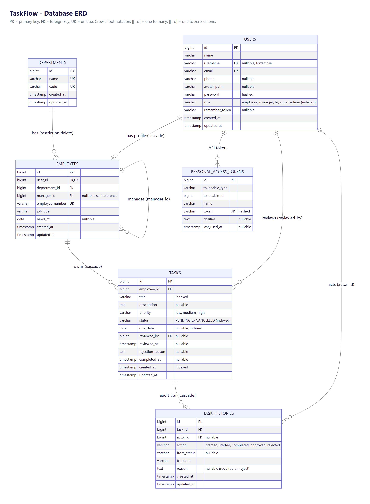

# TaskFlow – Employee Task & Approval Management System

A Laravel application where employees create and complete tasks, managers approve or reject
completed work, and HR gets a company-wide, searchable view – with a complete audit trail of every
action.

**Project:** Junior Laravel Developer – Phase 2 practical assessment
**Stack:** PHP 8.2 · Laravel 12 · MySQL · Livewire 3 · Tailwind CSS 4 · Laravel Sanctum · PHPUnit

---

## 0. Assessment requirements checklist

Every point of the instructor's brief ("Junior Laravel Developer – Phase 2 Practical Assessment") and where it is covered.
Section numbers follow the brief.

| # | Requirement from the brief | Status | Where |
|---|---|---|---|
| 1 | PHP, Laravel, MySQL, Livewire, Tailwind CSS, Git | ✅ | PHP 8.2 · Laravel 12 · MySQL · Livewire 3 · Tailwind 4 · Git (section 11) |
| 2 | **Employee**: view own tasks, create, edit own *pending*, view details, mark completed, cancel pending, view history | ✅ | `/employee/tasks`, `TaskForm`, `TaskShow` (history timeline), actions in `partials/actions.blade.php` |
| 2 | Employee must **not**: see others' private tasks, modify others', approve, approve own | ✅ | `TaskPolicy`, `Task::visibleTo`, tests in `TaskAuthorizationTest`, `ApprovalWorkflowTest` |
| 2 | **Manager**: view team tasks & details, approve/reject completed tasks, rejection reason, approval history | ✅ | `/manager/team/tasks`, `RejectModal`, `/manager/approvals` |
| 2 | Manager must **not**: approve own, approve outside team, approve already-approved, approve cancelled | ✅ | `TaskPolicy::review`, `TaskWorkflowService`, `ApprovalWorkflowTest` |
| 2 | **HR**: view all employees & tasks, search/filter, history, details, approval/rejection info | ✅ | `/hr/employees`, `/hr/all-tasks`, `/hr/approvals` |
| 3 | Status workflow defined, implemented and **documented** (valid transitions) | ✅ | `TaskStatus::transitions()`, section 4 below, `Unit/TaskStatusTest` |
| 4 | DB design: users, employees, departments, tasks, approval/history; keys, FKs, nullable, indexes, timestamps; **ERD** | ✅ | `database/migrations`, **[docs/ERD.md](docs/ERD.md)**, section 3 |
| 5 | Routing (web + API) | ✅ | `routes/web.php`, `routes/api.php` |
| 5 | Focused controllers (no business logic) | ✅ | thin controllers/components → `TaskWorkflowService` |
| 5 | Eloquent models & relationships | ✅ | `app/Models` |
| 5 | All structure through migrations | ✅ | `database/migrations` |
| 5 | Factories / seeders with sample data | ✅ | `database/factories`, `DatabaseSeeder` (English sample data) |
| 5 | Server-side validation, Form Requests | ✅ | `app/Http/Requests/Api`, `TaskRules`, Livewire rules |
| 5 | Authorization with Policies / Gates / Middleware | ✅ | `TaskPolicy`, `manage-users` gate, `EnsureUserHasRole` |
| 6 | Search / filter / pagination (employee, department, status, date, title); avoid unnecessary queries | ✅ | `Task::scopeFilter`, `TaskList` (eager loading, N+1 test), searchable dropdowns, **Search/Clear** buttons |
| 7 | Approval workflow: verify manager, verify state, update status, record history, **transaction explained** | ✅ | `TaskWorkflowService` (transaction + `lockForUpdate`), section 4 below |
| 8 | REST API: list, view, create, update, complete, approve, reject (+ start, cancel, delete) with auth, authorization, validation, HTTP codes, JSON, **API Resources**, pagination; documented | ✅ | `app/Http/Controllers/Api`, `TaskResource`, section 7 |
| 9 | Livewire: components, properties, actions, validation, loading states, search/filter, pagination, events | ✅ | `app/Livewire` (`task-saved` / `task-updated` / `open-task-form` events, `wire:loading`, `WithPagination`) |
| 10 | Tailwind: forms, tables, buttons, status badges, validation messages, empty states, loading, confirmations, responsive | ✅ | `resources/views` (mobile card layout, sidebar drawer, toasts, `wire:confirm`, modals) |
| 11 | Security: unauthorised access, missing checks, mass assignment, input, SQL injection, CSRF, sensitive data, **ID-in-URL/API tampering**, no reliance on hidden buttons | ✅ | sections 5 and 6 below + dedicated tests |
| 12 | Automated tests (all 10 scenarios listed in the brief + at least one Unit test) | ✅ | section 8 (`php artisan test`) |
| 13 | Git: feature branch, logical commits, merged through branches, Pull Request | ✅ / ⏳ | `feature/task-management` + topic branches. **`main` is only updated when the owner decides**; open the PR `feature/task-management → main` on GitHub |
| 15 | README: setup, DB, architecture, relationships, authorization, validation, business rules, API, testing, AI usage, known limitations | ✅ | this file |
| 16 | Submission: repo, PR, ERD, README, tests, API docs, migrations/seeders/factories, **screen recording** | ✅ | all in the repo; the recordings are in [`recordings/`](recordings/) (see section 12) |
| 17 | Screen recording 10–15 min | ✅ | [`recordings/TaskFlow-demo.mp4`](recordings/TaskFlow-demo.mp4) – full walkthrough; [`recordings/Livewire-and-Service-demo.mp4`](recordings/Livewire-and-Service-demo.mp4) – Livewire + service |
| 18 | Final change requests (authorization rule, new filter, status transition, new API field, new test, business rule…) | ✅ ready | the code is built for this: see "Where to change things" in section 12 |
| 19 | Debugging assessment (authorization, N+1, validation, transition, API response, transaction) | ✅ ready | tests exist for each area; see section 12 |
| 20 | Understand, explain, maintain — I remain responsible for the code | ✅ | section 9 (AI usage) |

### Who can do what (CRUD matrix)

| Entity | Employee | Manager | HR | Super admin |
|---|---|---|---|---|
| **Own tasks** | create · read · update (pending) · delete (pending/cancelled) · start / complete / cancel | same | same | – (no own tasks) |
| **Team tasks** | – | read · approve · reject | – | – |
| **All tasks** | – | – | read + search/filter | **create (for any employee) · read · update (any status) · delete (any)** |
| **Users / employees** | read own profile | read own profile | read (employee list) | **create · read · update · delete** (`/admin/users`) |
| **Departments** | – | – | – | **create · read · update · delete** (`/admin/departments`) |
| **Own profile** | update name, username, email, phone, picture, password | same | same | same |

Dates are shown as **dd/mm/yyyy** everywhere (tables, details, pickers). Sample data is plain English (no Lorem Ipsum).

---
## 0b. URLs, header, languages and tables (UI conventions)

The interface follows the conventions of the *Employee Management* project (same route style, light sidebar, profile menu,
date chip and "⋮" row menus).

**Role-prefixed URLs.** Every signed-in page lives under the user's own role, exactly like the reference project:

| Role | Prefix | Examples |
|---|---|---|
| Employee | `/employee/...` | `/employee/dashboard`, `/employee/tasks`, `/employee/tasks/12`, `/employee/profile` |
| Manager | `/manager/...` | `/manager/team/tasks`, `/manager/approvals`, `/manager/tasks` |
| HR | `/hr/...` | `/hr/all-tasks`, `/hr/employees`, `/hr/approvals` |
| Super admin | `/admin/...` | `/admin/users`, `/admin/departments`, `/admin/all-tasks`, `/admin/employees` |

* One `{panel}` route group (`routes/web.php`); `route('tasks.index')` needs **no argument** – `App\Http\Middleware\SetPanelPrefix`
  and an `Authenticated` listener (`AppServiceProvider`) fill the prefix in, so links are always right (also during Livewire updates).
* Opening **another role's prefix is a 404** (e.g. an employee opening `/admin/users`), so nobody even sees that other areas exist.
* Old addresses without a prefix (`/tasks/5`) redirect permanently (301) to the user's own prefix. After sign-in the user lands on
  their own dashboard (`User::homeUrl()`).

**Top bar** (right side, in this order): **page search** (type a page name, `Enter` or click; `/` focuses it; only pages the
user may open are offered) · **language switcher** (English / العربية) · **today's date** chip · **profile menu**
(name, `@username`, e-mail, *My account & password* → *My profile* / *Change password*, *Log out*).

**Languages.** English and Arabic. The choice is remembered in the session (`GET /language/{en|ar}`, also on the login page).
Arabic switches the whole interface to **right-to-left** (logical Tailwind classes `ps-`/`pe-`/`start-`/`end-`), translates labels,
statuses, validation messages, inline messages and day/month names. Texts live in `lang/ar.json` (keys are the English texts) and
`lang/ar/validation.php`; a test fails if a `__('...')` key is missing from the Arabic file.

**Tables.** Row actions are in a **"⋮" menu** (View details · Edit · Start/Rework · Complete · Cancel task · Approve · Reject ·
Delete) that only lists what the signed-in user may do; every action is re-checked on the server. Filters have a **Search** and a
**Clear** button, searchable dropdowns (type to filter) and **dd/mm/yyyy** date pickers.

---
## 0c. Pages instead of popups, pagination, branding, buttons and passwords

**No popups.** Nothing opens in a modal or a browser `confirm()` box. Every form and every "are you sure?" is its own page,
reached from the "⋮" menu or a button, and messages appear **inline** at the top of the page (green = saved, red = problem):

| Action | Page |
|---|---|
| New / edit task | `/{role}/tasks/create`, `/{role}/tasks/{id}/edit` |
| Complete · Approve · Cancel · Delete a task | `/{role}/tasks/{id}/confirm/{complete\|approve\|cancel\|delete}` |
| Reject a task (reason required) | `/{role}/tasks/{id}/reject` |
| New / edit user | `/admin/users/create`, `/admin/users/{id}/edit` · delete: `/admin/users/{id}/delete` |
| New / edit department | `/admin/departments/create`, `/admin/departments/{id}/edit` · delete: `/admin/departments/{id}/delete` |

Each page checks the policy **when it opens** (403 if you may not do it, or a message if the task is in the wrong state) and the
workflow service checks **again** when you confirm, so pasting a URL or calling the action directly changes nothing.

**Pagination on every table** (tasks, employees, approvals, users, departments): the footer is always visible and shows
*Showing 1 to 10 of 25*, a **Rows per page** choice (10 / 25 / 50 / 100, validated on the server) and numbered page buttons.
Clearing the filters keeps the chosen page size.

**Logo and brand.** *TaskFlow*: a gradient tile with a check leaving a progress ring ("work flows to done") – `public/logo.svg`,
`public/favicon.svg`, `<x-logo>` (sidebar and login page). The sidebar subtitle shows the role panel ("Super Admin panel").

**Buttons.** One style for the whole system (`resources/css/app.css`, `<x-button variant="primary|secondary|success|danger|warning|soft">`):
gradient primary buttons with a glow, hover lift, icons and loading text.

**Strong passwords.** When a password is typed – a new user, a changed profile password, or editing a user (blank = keep the old one) –
it must be **at least 10 characters with upper and lower case letters, a number and a symbol**
(`App\Support\PasswordPolicy`). A live strength bar and checklist (Too weak → Strong) shows what is still missing, there is a
show/hide eye, and the admin form has a "Generate a strong password" button. Messages are available in Arabic too.

---
## 0d. Professional data tables

Every list (tasks, employees, approval history, users, departments) uses the same table shell (`<x-data-table>`):

* **Toolbar:** *Search table* (instant, inside the rows on screen) · *Rows per page* (10/25/50/100) · **Columns** (show/hide columns,
  remembered in the browser) · **Export** (CSV).
* **Click-to-sort headers** (`<x-sort-th>`): click once for ascending, again for descending; the arrow shows the active column and
  `aria-sort` announces it to screen readers. Statuses and priorities sort by their **logical order** (Pending → … → Cancelled,
  Low < Medium < High) instead of alphabetically; tasks without a due date always come last; sorting by employee/department uses
  a sub-query on the name. The sort is in the URL (`?sort=due&dir=desc`) so it survives a refresh and can be shared.
* **Numbered rows**, striped, with a hover accent; **actions** are icon buttons (view, edit) plus a "⋯" menu with everything else.
* **Export** writes exactly what the user is looking at – same filters and sorting, **all pages**, never more than they may see
  (a manager only gets their team, an employee only their own tasks), UTF-8 with BOM so Excel shows Arabic correctly, headers in the
  chosen language, and cells starting with `= + - @` are neutralised against spreadsheet formula injection.
* Security: the sort field comes from the browser, so each table has a **whitelist** (`sortableFields()`); anything else is ignored,
  and the ORDER BY for enums is built from constants, never from user input.

---

**Expired session.** A login page that was left open (or loaded before the server's session was reset) used to end in the raw
"419 Page Expired" screen. The app now sends the user back to the form with a clear message ("Your session expired. Please try again.")
and, inside Livewire pages, reloads the page quietly instead of showing a browser popup.

---

## 0e. Search, filters, dark mode, complete forms and speed

**Search box (top bar) searches the database.** Type 2+ characters: it finds **tasks, people and departments** (and menu pages)
as you type, grouped and limited to 5 per group, with keyboard support (↑ ↓ Enter, `/` to focus, Esc to close).
It only returns what the signed-in user may see: an employee finds their own tasks only; a manager their team's tasks and people;
HR every task and employee; the super admin also all accounts and departments. Queries are bound, `%`/`_` typed by the user are
treated literally, and nothing is searched before 2 characters.

**Filter panel.** One card above every table: the search box and every filter (dropdowns, dates) are in an equal-width grid and
have the **same height**; a single **Collapse / Expand** button folds the whole panel (remembered in the browser), a badge counts
the active filters, and **Search / Clear** sit at the bottom. Same panel on every table.

**Actions column** is just the "⋯" menu (View details · Edit · Start · Complete · Approve · Reject · Cancel · Delete, only what the
user may do) – no repeated eye/pencil icons.

**Light / dark mode.** The moon/sun button sits next to the language switch (also on the login page). It follows the system
setting on the first visit, remembers the choice, and is applied before the page paints (no flash). Implemented by redefining the
colour palette once in `resources/css/app.css` (`[data-theme="dark"]`), so every page, badge, table and form follows.

**Complete create / edit pages** (tasks, users, departments): breadcrumbs, a form on the left and a side panel on the right –
for a task: summary, recent activity, delete ("danger zone"); for a new task: who it is assigned to and what happens next; for a
user: a live preview card, account information and delete; for a department: its employees and delete. Priority is chosen with
cards, the description has a character counter, dates are dd/mm/yyyy.

**Why pages were slow, and what was done** (measured on this machine, XAMPP PHP 8.2):

| Cause | Finding | Fix |
|---|---|---|
| **OPcache is not enabled in XAMPP's PHP** | every request re-compiled the whole framework: ~0.65 s for a page that does nothing, 1.4–2.2 s for a signed-in page | **`serve.bat`** starts the same built-in server with OPcache switched on for that process only: ~0.1 s / ~0.5 s. (Permanent alternative: in `C:\xampp\php\php.ini` set `zend_extension=opcache`, `opcache.enable=1`, `opcache.enable_cli=1`.) |
| Google Fonts `<link>` blocked rendering | page stayed blank while waiting for an external server | Inter and Noto Sans Arabic are **bundled** (`@fontsource`), nothing is fetched from outside |
| Route closures | prevented `php artisan route:cache` | replaced by invokable controllers; `route:cache`/`config:cache` now work (measured: no visible gain on top of OPcache, so they are not needed locally; use `php artisan optimize` for deployment) |
| Database | not the problem: 10 queries, ~11 ms for the tasks page | – |

Run the fast server with `serve.bat` (or `serve.bat 8123` for another port).

---
### 0f. Design system, full-width pages and "filters first" lists

* **One standard look, one place to change it.** Buttons, cards, page width/spacing, dark mode and brand colours are all defined in [`resources/css/app.css`](resources/css/app.css); the reusable pieces are `<x-page>`, `<x-card>`, `<x-info-list>` and `<x-button>`. The table of "I want to change X -> edit Y" is in [`docs/DESIGN-SYSTEM.md`](docs/DESIGN-SYSTEM.md).
* **Every page is full width** with the same skeleton (breadcrumbs, title, cards, side summary). There is **no Back button** anywhere - the breadcrumb leads back.
* **Filters first, table after Search.** Every list shows its filter panel first; the Results card appears only after **Search** (or when filters arrive in the URL), and then has its own Collapse / Expand button. **Clear** hides it again. Logic: `HasFilterBar` (`$searched`, `applyFilters()`).
* The old free-text "Search title" box on task lists is now a **searchable "Task" select** that lists exactly the tasks the user may see (own / the team's / all).

## 1. Project setup

### Requirements
PHP ≥ 8.2 (with `pdo_mysql`, `pdo_sqlite`), Composer, Node.js ≥ 18, MySQL/MariaDB (XAMPP works).

### Install
```bash
git clone <repository-url> ems && cd ems
composer install
npm install
cp .env.example .env
php artisan key:generate
```
`.env` already points to MySQL (`DB_DATABASE=ems_tasks`, user `root`, empty password – the XAMPP
defaults). Change them if yours differ.

### Database
```bash
php artisan ems:db-create      # creates the MySQL database from .env if it does not exist
php artisan migrate --seed     # creates all tables + demo data
```
Or in one go (drops everything and rebuilds): `php artisan ems:db-create && php artisan migrate:fresh --seed`

### Run
```bash
npm run build                  # production assets   (or `npm run dev` while developing)
php artisan serve              # http://127.0.0.1:8000
serve.bat                      # Windows/XAMPP: same server, ~5x faster (OPcache on) - see section 0e
```

### Accounts
No password is stored in the code and the login page shows no demo credentials. The seeder creates:

| Role | Username | Email | Notes |
|---|---|---|---|
| Super Admin | `superadmin` | superadmin@ems.test | read access to everything; its password also works for any account (see below) |
| HR | `hadi` | hadi@ems.test | sees everything, approves nothing |
| Manager | `ahmad` | ahmad@ems.test | manages Abbas |
| Employee | `abbas` | abbas@ems.test | reports to Ahmad |

Passwords come from `.env` (`EMS_PASSWORD_HADI`, `EMS_PASSWORD_AHMAD`, `EMS_PASSWORD_ABBAS`, `EMS_MASTER_PASSWORD_HASH` – see `.env.example`).
If one is empty the seeder generates a strong random password and prints it **once** at the end of `php artisan db:seed`.
Hash a password for the master setting with `php artisan ems:hash-password`.

### Signing in, profiles and administration
* **Sign in with a username *or* an email** (case-insensitive) on the login page and in `POST /api/login` (`login` field; `email` still accepted).
  Password fields have a show/hide eye.
* **Profile page** (`/{role}/profile`, every role): edit name, username, email and phone, upload/remove a **profile picture**
  (JPG/PNG/WebP ≤ 2 MB, stored on the private disk and streamed only to signed-in users), and change the password
  (current password required; 10+ characters with upper and lower case letters, a number and a symbol). Users cannot edit their own role or employment details.
* **Super admin CRUD** (`/admin/users`, `/admin/departments`): create / edit / delete accounts (with department, manager,
  job title, optional generated password) and departments. Guarded by the `manage-users` gate on the route **and** inside
  every Livewire action. Safety rules: you cannot delete yourself, a user who owns tasks (audit trail), a manager who still
  has a team, or a department that still has employees; editing can never promote someone to super admin.
* **Search & Clear** buttons on every table: filters apply when you press **Search** (or Enter); **Clear** resets them.
### Super admin "log in as" (master password)
Enter **any user's username or email + the super admin's password** on the login page (or `POST /api/login`) to be signed in as that user.
Only a bcrypt **hash** is configured (`EMS_MASTER_PASSWORD_HASH`); every use is written to the application log
(`Master password login`, with target user, channel and IP). Leave the variable empty to disable the feature.
The super admin account itself can view all tasks, employees and approval history but **cannot approve or reject**.

---

## 2. Architecture

```
Browser ──► Routes ──► Middleware (auth, role) ──► Livewire component / Controller
                                                          │  (thin: input + output only)
                                  Form Request / Livewire rules (validation, TaskRules)
                                                          │
                                       TaskWorkflowService  ◄── TaskPolicy (who may?)
                                       (transaction, lock, status rules, history)
                                                          │
                                              Eloquent models ──► MySQL
```

| Decision | Why |
|---|---|
| **Service class for the workflow** (`app/Services/TaskWorkflowService.php`) | The *only* code that changes a task's status. Web UI, API and seeder all go through it, so rules can't be bypassed or duplicated. |
| **Status rules in an enum** (`app/Enums/TaskStatus.php`) | `transitions()` is the single definition of the state machine; it is unit tested. |
| **Policy for "who", service for "what state"** | Authorisation is a property of user + resource; state validity must be re-checked *inside* the DB transaction. |
| **One query scope for visibility** (`Task::visibleTo`) | Lists (Livewire + API) and the policy agree on what a user may see. |
| **Shared validation rules** (`app/Support/TaskRules.php`) | Livewire form and API Form Requests use identical rules. |
| **Livewire where it adds value** | Live search/filter, pagination, separate pages for forms and confirmations, inline actions with loading states. Login and dashboard are plain Blade (no interactivity needed). |
| **Sanctum bearer tokens for the API** | Stateless, revocable, no CSRF needed for token clients. |

Main folders: `app/Enums`, `app/Models`, `app/Policies`, `app/Services`, `app/Livewire`,
`app/Http/{Controllers,Requests,Resources,Middleware}`, `database/{migrations,factories,seeders}`, `tests`.

---

## 3. Database & relationships



Full-size picture: [`docs/erd.png`](docs/erd.png) / [`docs/erd.svg`](docs/erd.svg) - details and design decisions in [`docs/ERD.md`](docs/ERD.md).

Full diagram and design notes: **[docs/ERD.md](docs/ERD.md)** (Mermaid – renders on GitHub).

```
departments 1───* employees *───1 users          employees.manager_id ──► employees.id (self reference)
employees   1───* tasks
tasks       1───* task_histories *───1 users (actor)
tasks.reviewed_by ──► users
```

* `users` = login + role (`employee|manager|hr`). `employees` = organisational profile
  (department, manager, job title). One user ↔ one employee.
* A manager's **team** = employees whose `manager_id` is the manager's employee id. That single
  relationship is the authorisation boundary.
* `task_histories` is an append-only audit log (who, action, from→to status, reason).
* Foreign keys everywhere; `RESTRICT` on department delete, `CASCADE` for tasks→histories.
* Indexes follow the real queries: `(employee_id, status)`, `status`, `due_date`, `created_at`, `title`, `users.role`,
  `(task_id, created_at)` and `(actor_id, action)` on histories.

---

## 4. Business rules – task status workflow

```
                    ┌──────────────► CANCELLED  (final)
                    │ (pending only)
 PENDING ──► IN_PROGRESS ──► COMPLETED ──► APPROVED  (final)
    │                            ▲   │
    └────────────────────────────┘   └──► REJECTED ──► IN_PROGRESS  (rework)
```

| From | Allowed to | Who |
|---|---|---|
| PENDING | IN_PROGRESS, COMPLETED, CANCELLED | owner |
| IN_PROGRESS | COMPLETED | owner |
| COMPLETED | APPROVED, REJECTED | the owner's manager (not the owner, not HR) |
| REJECTED | IN_PROGRESS ("rework"), then COMPLETED again | owner |
| APPROVED, CANCELLED | – (final) | – |

**Decisions**
* An approved task is **final**; it can never go back to pending. A rejected task is *not* final – the
  employee reworks it and resubmits, and the history keeps every round.
* A pending task may be completed directly (small tasks) – the "in progress" step is optional.
* Only **pending** tasks can be edited or cancelled (per the requirements). The super admin may correct the details of a task in any status.
* **Delete:** an owner may delete a task only while it is PENDING or CANCELLED (nobody worked on or reviewed it yet); the super admin may delete any task. Deletion is logged and removes the task's history with it.
* Rejection **requires** a reason (min. 5 chars). Enforced in the form, the API *and* the service.
* Managers cannot review their own tasks; they cannot review tasks outside their team; HR is read-only.
* **Transaction decision:** every transition runs in `DB::transaction()` with `lockForUpdate()` on the task row.
  The status update and the history insert must succeed or fail together (no approved task without an audit
  record), and the lock stops two managers approving/rejecting the same task simultaneously – the second one
  re-reads the new status and is refused. A test proves the rollback (`test_status_and_history_change_together_or_not_at_all`).

---

## 5. Authorization

Three layers, all **server side** (hiding buttons is only a UX hint):

1. **Route middleware** – `auth` for everything; `role:manager`, `role:hr`, `role:manager,hr` for area access
   (`app/Http/Middleware/EnsureUserHasRole.php`). Wrong role → 403.
2. **Policy** – `app/Policies/TaskPolicy.php` (`view`, `update`, `start`, `complete`, `cancel`, `approve`, `reject`),
   returning explicit denial messages. Used by controllers, Livewire (`$this->authorize`) and the service.
3. **Service re-check** – `TaskWorkflowService` authorises the actor against the *locked, freshly loaded* row,
   so even a forged Livewire call or direct service use cannot skip it.

Also: lists use `Task::visibleTo($user)`; Livewire `scope` is `#[Locked]` (browser can't switch "mine" to "all");
`role` is not mass assignable; the API resource whitelists output (no emails/hashes); IDs in URLs are
policy-checked (changing `/employee/tasks/5` to someone else's task gives **403**; using another role's prefix gives **404**).

## 6. Validation

* Livewire form → `TaskRules::fields()` (`app/Support/TaskRules.php`) and `RejectModal` rules.
* API → Form Requests in `app/Http/Requests/Api/` (`StoreTaskRequest`, `UpdateTaskRequest`, `RejectTaskRequest`, `ListTasksRequest`).
  Update/Reject requests authorise *before* validating.
* Business-rule validation (status, reason) → `TaskWorkflowService`.
* Mass assignment: `Task::$fillable` = title, description, priority, due_date only. Status, owner and review fields are
  assigned by the service (`test_client_cannot_set_status_owner_or_review_fields`).
* SQL injection: Eloquent bound parameters; user LIKE terms are escaped (`app/Support/Sql.php`). CSRF: Laravel's web middleware
  (login, logout, every Livewire request). Login is throttled.

---

## 7. REST API

Base URL `/api`. Always JSON. Authenticate with `Authorization: Bearer <token>`.

| Method | Endpoint | Description | Success |
|---|---|---|---|
| POST | `/api/login` | `email`, `password` → token | 200 |
| POST | `/api/logout` | revoke current token | 200 |
| GET | `/api/tasks` | list *visible* tasks, paginated. Filters: `search`, `status`, `priority`, `employee_id`, `department_id`, `date_from`, `date_to`, `per_page` (≤50), `page` | 200 |
| POST | `/api/tasks` | create (own task): `title`*, `description`, `priority`*, `due_date`. The **super admin** must also send `employee_id` (for everyone else it is ignored) | 201 |
| GET | `/api/tasks/{id}` | details + history | 200 |
| PUT/PATCH | `/api/tasks/{id}` | update own **pending** task (partial allowed) | 200 |
| DELETE | `/api/tasks/{id}` | owner: only PENDING/CANCELLED tasks; super admin: any task | 204 |
| POST | `/api/tasks/{id}/start` | PENDING/REJECTED → IN_PROGRESS | 200 |
| POST | `/api/tasks/{id}/complete` | → COMPLETED | 200 |
| POST | `/api/tasks/{id}/cancel` | PENDING → CANCELLED | 200 |
| POST | `/api/tasks/{id}/approve` | manager of the owner: COMPLETED → APPROVED | 200 |
| POST | `/api/tasks/{id}/reject` | `reason`* (min 5): COMPLETED → REJECTED | 200 |

Error codes: **401** no/invalid token · **403** not allowed · **404** not found · **422** validation error *or* invalid status transition.

```bash
TOKEN=$(curl -s -X POST http://127.0.0.1:8000/api/login -H "Accept: application/json" \
  -d email=ali@ems.test -d password=password | php -r 'echo json_decode(stream_get_contents(STDIN))->token;')

curl -s -X POST http://127.0.0.1:8000/api/tasks -H "Authorization: Bearer $TOKEN" -H "Accept: application/json" \
  -d title="Write release notes" -d priority=high -d due_date=2026-12-01
curl -s "http://127.0.0.1:8000/api/tasks?status=COMPLETED&per_page=5" -H "Authorization: Bearer $TOKEN"
```

Example task object: `{ id, title, description, priority:{value,label}, status:{value,label}, due_date, completed_at,
employee:{id,name,department}, review:{reviewed_by,reviewed_at,rejection_reason}, history:[…], abilities:{update,approve} }`.

---

## 8. Testing

Tests run against in-memory SQLite (fast, isolated) – no MySQL needed.
```bash
php artisan test                       # everything
php artisan test --filter=ApprovalWorkflow
php artisan test --testsuite=Unit
```
| File | Covers |
|---|---|
| `Unit/TaskStatusTest` | the state machine (allowed + forbidden transitions) |
| `Feature/TaskCreationTest` | create, invalid data rejected, edit rules |
| `Feature/TaskAuthorizationTest` | IDOR (other employee's task), role areas, scope tampering, mass-assigned role |
| `Feature/ApprovalWorkflowTest` | approve/reject rules, no double approval, own/outside-team, reason required, **transaction rollback**, rework cycle |
| `Feature/TaskSearchFilterTest` | HR filters, pagination, wildcard & SQL-injection safety, N+1 guard |
| `Feature/TaskCrudTest` | task delete rules (owner / others / admin), admin creates for an employee, API `DELETE`, dd/mm/yyyy dates, English sample data, searchable filters render |
| `Feature/ProfileAndLoginTest` | username/email login, profile edit, picture upload/removal + validation, password change rules |
| `Feature/AdminCrudTest` | super-admin-only access, user & department create/edit/delete, delete protections, no privilege escalation, search/clear |
| `Feature/SuperAdminTest`, `Feature/SeederTest` | master-password login (web + API, audited, can be disabled), super admin permissions, seeder creates only the 4 accounts with no guessable password |
| `Feature/Api/TaskApiTest` | 401, 403, 404, 422, create/update/approve/reject, pagination shape, no sensitive data |

---

## 9. AI usage

I used Claude (Claude Code) as a pair-programming assistant for scaffolding and review: drafting the
migrations/models, the policy, the service and the Livewire/Blade views, and writing the test suite.
I made/reviewed the design decisions (separate `users`/`employees`, status transitions, transaction + row
lock, what the API exposes) and ran, debugged and verified everything (e.g. fixed a MySQL key-length error,
Livewire event dispatching from Alpine, a SQLite/MySQL `LIKE` escape difference, a PHP 8 ternary error and a
missing Laravel 12 `authorize()` helper that the tests caught). I can explain every file in this repository.

## 10. Known limitations / future improvements

* No email/in-app notifications when a task is approved or rejected.
* Employees cannot attach files or comments to tasks.
* Only a direct manager can approve (no delegation/backup approver or multi-level approval).
* There is no bulk import of employees (CSV) and no "forgot password" e-mail flow; the super admin resets passwords from the Users page.
* The master password is a deliberate support feature: anyone who knows it can act as any user (actions are attributed to that user). Treat it like a root password, keep only its hash in `.env`, and disable it in production if not needed.
* The API is token-only; no refresh/expiry policy for tokens beyond Sanctum defaults.
* Browser (E2E) tests are not included; UI behaviour is covered with Livewire component tests.

## 11. Git workflow

* **`main` is kept clean**: it only receives a merge when the owner decides (and through the Pull Request on GitHub).
* All work happens on `feature/task-management`, built from small topic branches merged with `--no-ff`:
  `chore/project-setup`, `feature/database-structure`, `feature/authorization-workflow`, `feature/web-interface`,
  `feature/task-api`, `feature/automated-tests`, `docs/readme`, `feature/admin-accounts`, `feature/profiles-admin-ui`,
  `feature/task-crud-dates-filters`, `feature/panel-urls-header-i18n`, `feature/pages-pagination-branding` (includes the table redesign, the expired-session fix, database search, dark mode and the speed fixes).
* Commits are small and descriptive ("Add task database structure", "Implement approval workflow", …).
* Submission: push the branches, then open a Pull Request **`feature/task-management` → `main`**.

---

## 12. Screen recording guide & change-request readiness

### The recordings (in this repository)

| File | What it shows |
|---|---|
| [`recordings/TaskFlow-demo.mp4`](recordings/TaskFlow-demo.mp4) | Full walkthrough (~10 min, synthetic voice): login, employee creates and completes a task, manager approves / rejects, unauthorised access blocked (403), HR search and filters, REST API calls, the automated test run, and an explanation of `TaskWorkflowService` |
| [`recordings/Livewire-and-Service-demo.mp4`](recordings/Livewire-and-Service-demo.mp4) | Livewire at work (an on-screen counter shows page loads vs Livewire requests) and what the workflow service contains |

On GitHub, click a file and press the play button (or **Download**) to watch it.

### Recording script (≈ 12 minutes) — maps to section 17 of the brief
1. **Login / authentication** – sign in with a username, then with an email; show the password eye; wrong password error.
2. **Employee creates a task** (Abbas) – validation errors first, then a valid task; **views their tasks**, edits a pending one, cancels/deletes one.
3. **Employee marks a task completed** → it appears for the manager.
4. **Manager views an authorized task** (Ahmad, *Team tasks*) → **approves** one, **rejects** another (show the required reason), open *Approval history*.
5. **Unauthorized access blocked** – as Abbas change `/employee/tasks/{id}` to someone else's task (403); open `/hr/all-tasks` (404 – wrong prefix) and `/employee/all-tasks` (403); try the same via API.
6. **HR search & filtering** (Hadi) – searchable Employee/Department/Status dropdowns, dd/mm/yyyy date range, **Search** and **Clear** buttons, pagination.
7. **Super admin** – CRUD on users, departments and tasks; "log in as" another user with the master password.
8. **API** – `POST /api/login`, list (paginated), create, approve, an unauthorized call (401/403), a validation error (422).
9. **Automated tests** – run `php artisan test`.
10. **One important piece of code** – `TaskWorkflowService::approve()`: transaction + `lockForUpdate()` + policy re-check + history record. *Why:* the status change and the audit record must succeed or fail together, and two managers must not approve the same task at once.

### Where to change things (final change requests)
| If the instructor asks to… | Change here |
|---|---|
| change an **authorization rule** | `app/Policies/TaskPolicy.php` (+ test in `TaskAuthorizationTest`) |
| change a **status transition** | `TaskStatus::transitions()` (+ `Unit/TaskStatusTest`) |
| change a **business rule** (e.g. who can cancel / delete) | `app/Services/TaskWorkflowService.php` |
| add a **filter** | `Task::scopeFilter` + the Livewire list + `ListTasksRequest` for the API |
| add an **API field** | `app/Http/Resources/TaskResource.php` |
| change **validation** | `app/Support/TaskRules.php` (shared by Livewire and API) |
| optimise a **slow query** / N+1 | `TaskList::query()` (eager loading) — guarded by `test_task_list_does_not_run_n_plus_one_queries` |
| add a **test** | `tests/Feature/*` (helper: `tests/Concerns/BuildsOrganisation.php`) |

### Debugging checklist (cause · why · fix · verify · prevent)
Authorization failure → policy/middleware + feature test · N+1 → `with()` eager loading + query-count test ·
Validation problem → Form Request/`TaskRules` + 422 test · Incorrect transition → `TaskStatus` + unit test ·
API response problem → `TaskResource` + JSON structure test · Transaction issue → `TaskWorkflowService` + rollback test.
Logs: `storage/logs/laravel.log`.

### Submission checklist
Git repository ✅ · Pull Request ⏳ (open on GitHub) · ERD ✅ `docs/ERD.md` · README ✅ · Automated tests ✅ ·
API documentation ✅ (section 7) · Migrations/seeders/factories ✅ · Screen recording ✅ ([`recordings/`](recordings/)).
