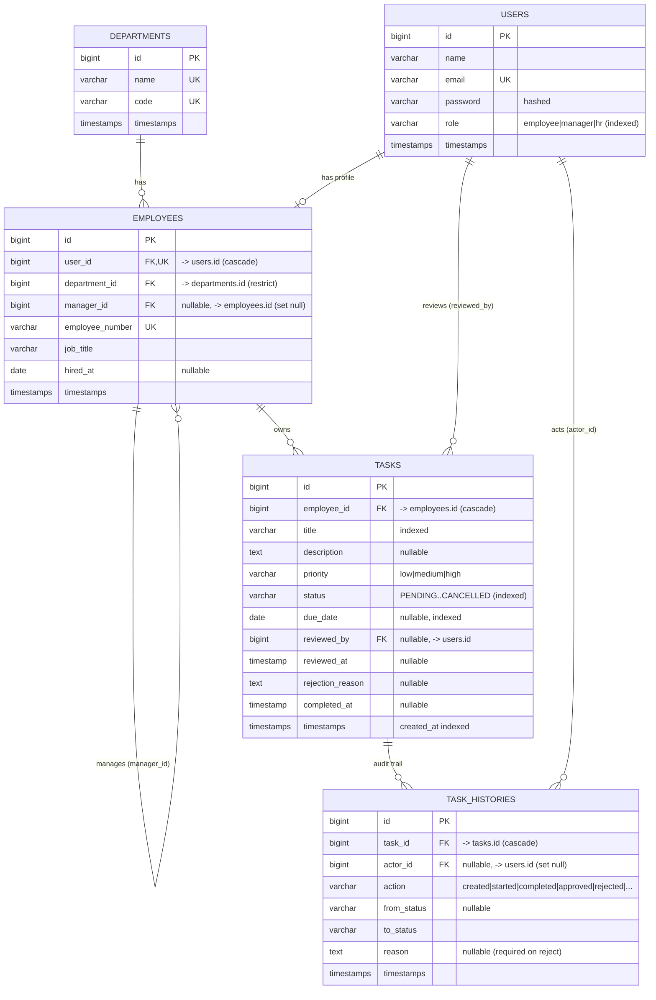

# Database ERD

Rendered automatically by GitHub (Mermaid).

## Design decisions

| Decision | Reason |
|---|---|
| `users` (login/role) separate from `employees` (HR profile) | Authentication data and organisational data change for different reasons. Keeps the `users` table small and lets the org structure evolve independently. |
| `employees.manager_id` self-reference | A manager's "team" is simply `employees WHERE manager_id = me`. One query defines the authorisation boundary for both the UI and the API. |
| `tasks.employee_id` points to **employees**, not users | Tasks belong to a position in the organisation, so department/manager can be derived by joining. |
| `task_histories` is append-only | Required "approval history". Stores who, what, from/to status and the reason, so the trail can never be silently rewritten. |
| `tasks.reviewed_by / reviewed_at / rejection_reason` | Denormalised *latest* review for fast list display; the complete record is in `task_histories`. |
| Composite index `(employee_id, status)` | Serves "my tasks by status" and the manager team scope. |
| Indexes on `status`, `due_date`, `created_at`, `title` | Back the HR filters (status, date range, title) and the default ordering. |
| `restrictOnDelete` on `employees.department_id` | A department that still has staff cannot be removed accidentally. |
| `cascadeOnDelete` for task → histories | Histories have no meaning without their task. |
